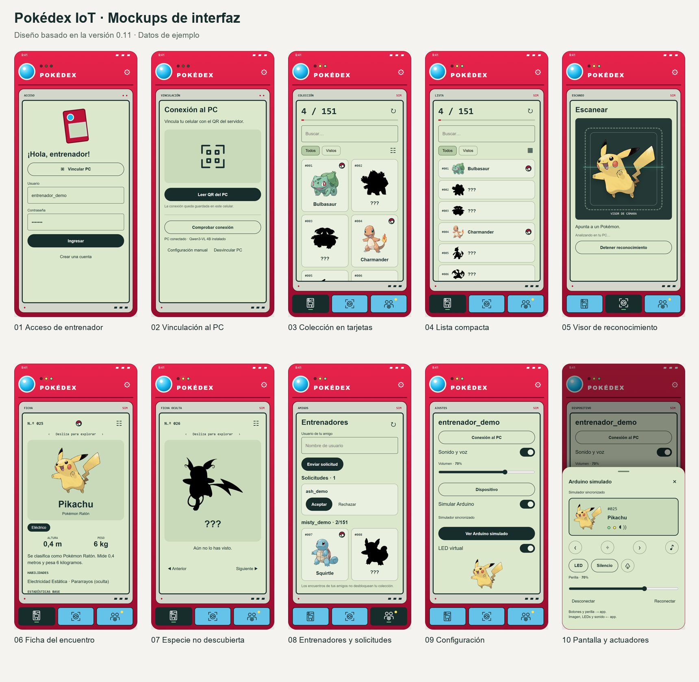

# Pokédex IoT — versión 0.11

App Android en **Kotlin + Jetpack Compose** y servidor local del PC también en **Kotlin/JVM**.

## Documentación de la entrega

- **[Informe solo de mockups en PDF](docs/mockups/Informe_Mockups_Pokedex_IoT.pdf)**: diez pantallas, mapa de navegación e interacciones.
- [Mockups y fuentes editables](docs/mockups/README.md).
- [Informe de desarrollo y verificación](docs/Informe_Pokedex_UA2.pdf).
- [Resultados de las 56 pruebas](docs/evidencia/summary.json) y [casos ejecutados](docs/evidencia/cases.csv).



Estas imágenes son composiciones de diseño con datos de ejemplo. Documentan la interfaz actual de la app; no representan pruebas ejecutadas en teléfonos.

## Qué está implementado

- Registro e inicio de sesión en el PC, con cuentas compartidas entre celulares.
- Base de datos SQLite: usuarios, sesiones, encuentros y amigos.
- Solicitudes de amistad por nombre, aceptación o rechazo y colecciones compartidas tras aceptar.
- LED amarillo de notificaciones en la carcasa y aviso en el icono Amigos. Actualización automática cada cinco segundos con la app en primer plano.
- Catálogo de las 151 especies originales, de Bulbasaur a Mew, con imágenes y fichas locales en español.
- Cámara integrada en vivo con CameraX: se abre al tocar el icono de escaneo. Selección opcional desde la galería tras detenerla.
- Lectura automática de QR en el celular, sin tomar ni confirmar fotos.
- Reconocimiento continuo: envía un fotograma al PC por HTTPS, espera la respuesta y vuelve a analizar el más reciente. No acumula imágenes.
- Servidor que consulta `qwen3-vl:4b` mediante Ollama en `127.0.0.1:11434`.
- Respuestas diferenciadas: identificado, no identificado, fuera del catálogo y error.
- Registro de los identificados por el modelo, separado de las pruebas manuales.
- Switch «Simular Arduino», carcasa virtual roja inspirada en la referencia, lente azul, LEDs, LCD y controles funcionales.
- Estado compartido entre app y Arduino simulado: ficha, LED verde, solicitudes, sonido y volumen. Botones y perilla simulados controlan la app por el mismo protocolo preparado para hardware.
- Tras reconocer una especie del catálogo, se cierra la cámara y aparece la ficha con transición, arranque robótico y descripción hablada automática.
- Fichas con deslizamiento lateral, tarjetas y lista compacta intercambiables; navegación inferior solo con iconos.
- Vinculación por QR y conexión guardada con AES-GCM mediante Android Keystore.

**Pendiente:** Arduino físico y validación completa en dos celulares reales. La clave de conexión al PC y la contraseña del usuario son distintas. El usuario confirmó un reconocimiento desde su celular; esto no valida la precisión de las 151 especies.

## Conexión

Celular → HTTPS por Wi-Fi → servidor Kotlin del PC → Ollama local → resultado → app.

El reconocimiento funciona tanto con el switch activado como desactivado. El switch selecciona el transporte simulado o el punto de conexión del real. Mientras el dispositivo real no esté integrado, su modo muestra «sin conexión» y no envía comandos físicos. La app conserva el estado solicitado, pero solo muestra una salida confirmada del dispositivo cuando recibe su ACK.

## Iniciar el PC

Requisitos: Java/JDK 17 y Ollama instalado. Para reconocimiento, `qwen3-vl:4b` debe estar instalado (ya lo está en este equipo).

Desde PowerShell, en la carpeta del proyecto, ejecuta:

```powershell
.\Start-Backend.ps1
```

El comando selecciona una red física con puerta de enlace, inicia Ollama si no responde, comprueba que el modelo esté instalado, compila y arranca el servidor Kotlin con SQLite, y abre el QR en el navegador cuando el servidor ya está escuchando. No descarga ni ejecuta el modelo automáticamente. Si falta el modelo, usuarios y amigos siguen disponibles y aparece el comando para instalarlo.

Mantén la terminal abierta. **Ctrl+C detiene el servidor y la página del QR; Ollama queda disponible**, incluido si ya lo utilizabas antes. Si ejecutas el comando otra vez con el mismo backend activo, abre el QR existente sin duplicar el servidor.

Si hay varias redes conectadas, selecciona la IP que comparte la red con tu celular:

```powershell
.\Start-Backend.ps1 -BindAddress 192.168.1.90
```

El script anterior `tools/Start-PokedexPC.ps1` sigue funcionando y ahora tiene el mismo arranque completo. El navegador abre `http://127.0.0.1:8444` únicamente en el PC. Si el navegador no puede abrirse, el servidor muestra esa dirección para abrirla manualmente.

La dirección Wi-Fi observada al preparar esta versión fue `192.168.1.90`; puede cambiar. El script compila el servidor, crea un certificado y una clave privados la primera vez y muestra:

- Dirección: `https://<IP-del-PC>:8443`
- Huella SHA-256 del certificado.
- Clave de conexión.

Mantener esa terminal abierta. Ctrl+C detiene el servidor. Iniciarlo no ejecuta ninguna inferencia. Los archivos privados quedan en `%LOCALAPPDATA%\PokedexIoT`, fuera de la carpeta de OneDrive del proyecto. No compartirlos ni subirlos al repositorio.

Si Windows pregunta por Java, permitir acceso únicamente en la red privada utilizada para la presentación. Este proyecto no cambia el firewall automáticamente ni abre puertos del router. Una red que aísle clientes puede impedir que el celular alcance al PC.

## Conectar el celular físico

1. Instalar `app/build/outputs/apk/debug/app-debug.apk`. Es una APK de depuración para pruebas.
2. Antes de ingresar, vincular el PC con su QR desde la propia pantalla de login. Crear una cuenta o entrar con una cuenta de ese servidor; la cuenta local de versiones anteriores no se migra automáticamente.
3. En el navegador **del PC**, abrir `http://127.0.0.1:8444`. En la app, usar **Leer QR del PC** dentro de Ajustes (engranaje), disponible también antes del login, permitir la cámara y apuntar al QR completo. Se detecta automáticamente, guarda la conexión y cierra el lector. El QR se procesa solo en el celular.
4. Pulsar **Comprobar conexión**. Consulta disponibilidad e instalación del modelo; no ejecuta reconocimiento. Si no puedes usar la cámara, abre **Configuración manual**, copia los tres datos de la terminal y pulsa **Guardar y comprobar**.
5. Tocar el icono central de **Escanear**: abre la cámara directamente. La primera vez Android pide permiso; después, basta apuntar a un Pokémon.
6. El visor permanece en vivo y envía fotogramas automáticamente al PC. Solo hay una consulta pendiente, con al menos dos segundos entre capturas. **Detener reconocimiento**, salir de la pantalla o pasar a segundo plano detiene nuevos envíos. Una consulta ya enviada puede continuar y guardar un encuentro en el PC. Su respuesta se descarta en el visor detenido; al actualizar la colección se verá si el PC la guardó. Se espera su finalización antes de iniciar otra.
   Como alternativa, detener el reconocimiento y usar **Elegir imagen → Identificar**.
7. Si reconoce una de las 151 especies, la app guarda el encuentro. Revisar que coincida con el fotograma analizado; no se presenta como una identificación garantizada.
8. Al abrir la ficha reconocida, suena el efecto robótico y se narra la descripción automáticamente. **Escuchar ficha** la repite. Hace falta una voz española instalada y el sonido habilitado en Ajustes.

La primera consulta puede tardar más mientras carga el modelo (tiempo máximo de espera: tres minutos). En el registro de una prueba realizada por el usuario antes de v0.9, Ollama tardó 11,78 s en responder; unos 4,52 s correspondieron al procesamiento y la generación internos. No se ha medido todavía la mejora de v0.9. No usar el emulador; las pruebas de uso se realizan en celular físico.

La dirección, la huella y la clave se guardan cifradas en el celular. Cerrar sesión, cerrar la app o reiniciar no elimina la vinculación. **Desvincular PC** borra esos datos del celular; no cambia la clave del servidor ni desconecta otros celulares. El login de usuario es independiente: su contraseña no se guarda en el teléfono. La sesión de usuario permanece en memoria hasta cerrar la app o cerrar sesión, mientras que la vinculación al PC se conserva.

El QR conserva los mismos datos mientras no cambien la IP, el certificado o la clave del servidor. Si cambia alguno, vuelve a escanearlo. Si desinstalas la app, borras sus datos o Android pierde la clave de cifrado, tendrás que vincular de nuevo. El certificado generado dura un año.

La página del QR solo escucha en `127.0.0.1:8444`, exige el host local y evita caché e incrustación. Contiene credenciales: no publiques capturas. La comunicación del celular sigue usando HTTPS en el puerto 8443. La página no necesita internet y no ejecuta Qwen.

## Base de datos y amigos

El archivo está en `%LOCALAPPDATA%\PokedexIoT\pokedex.db`, fuera de OneDrive. Se crea automáticamente al iniciar el servidor y persiste al reiniciarlo. No requiere instalar un motor ni abrir otro puerto. El celular accede por la misma API HTTPS. Para respaldarlo, detén el servidor y copia el archivo.

Tablas: `users` (cuentas y hashes), `sessions` (sesiones con vencimiento), `seen` (especie y origen por usuario), `friends` (vínculos de amistad) y `friend_requests` (solicitudes pendientes). La clave compuesta de `seen` impide duplicar un Pokémon por cada fotograma; una prueba manual nunca rebaja un encuentro ya reconocido por cámara.

1. Ambos celulares escanean el QR del mismo PC y crean cuentas distintas, por ejemplo `ana` y `pedro`.
2. Pedro registra un Pokémon con la cámara o con **Ajustes → Dispositivo → Prueba manual**.
3. Ana abre **Amigos**, escribe `pedro` y pulsa **Enviar solicitud**.
4. El destinatario recibe la solicitud en **Amigos**. Su LED amarillo parpadea; puede tocarlo para abrir las solicitudes.
5. Al aceptar, ambos aparecen como amigos. Rechazar elimina la solicitud sin crear amistad. El LED se apaga cuando ya no hay solicitudes recibidas pendientes.

Las nuevas amistades requieren aceptación del destinatario autenticado. No se comparte su colección mediante una solicitud pendiente. Los vínculos creados con versiones anteriores se conservan al actualizar; no se borran cuentas, amigos ni encuentros. Los usuarios se normalizan a minúsculas y admiten 3–30 letras ASCII, números o guion bajo.

Los registros locales antiguos quedan intactos pero no se mezclan con cuentas nuevas. Las cuentas compartidas requieren el servidor encendido. La app no mantiene una cola sin conexión: ante un error muestra el fallo y permite reintentar; Actualizar recupera lo guardado en el PC. Al cambiar de usuario se limpia la colección que estaba en memoria.

Pruebas automatizadas con SQLite temporal verifican persistencia tras reapertura, actualización del esquema anterior, usuarios separados, aceptación y rechazo de solicitudes, deduplicación, contraseñas incorrectas y revocación de sesiones. Una prueba HTTP usa tres cuentas ficticias: comprueba que no se puede escribir en la colección ajena ni aceptar una solicitud de otra persona enviando identificadores falsos.

## Archivos para explicar en clase

| Archivo | Función |
| --- | --- |
| `DexApp.kt` / `DexChrome.kt` | Pantallas dentro de la carcasa, navegación, fichas, siluetas y Poké Balls. |
| `PokedexModel.kt` | Coordina captura, peticiones y resultados sin bloquear la interfaz. |
| `LiveCamera.kt` / `LiveSession.kt` | Visor, permiso, lectura QR, fotogramas y descarte de respuestas de sesiones detenidas. |
| `PhotoInput.kt` | Corrige orientación, reduce a un máximo de 1024 píxeles y genera JPEG sin metadatos. |
| `PcClient.kt` | Envía la foto por HTTPS y verifica el certificado del PC mediante su huella. |
| `Pokemon.kt` | Fichas del catálogo y búsqueda que protege las especies ocultas. |
| `DeviceSync.kt` | Estado compartido, mensajes, eventos de botones/perilla, ACK, plazos y transporte simulado. |
| `ArduinoTransport.kt` | Contrato del canal real y ensamblado de mensajes JSON fragmentados. |
| `ArduinoSimulator.kt` | Pantalla, LEDs, botones y perilla del Arduino virtual. |
| `LocalStore.kt` | Conexión cifrada al PC; los usuarios y encuentros ahora viven en SQLite. |
| `server/.../Database.kt` | Tablas y consultas SQL parametrizadas, contraseñas derivadas y sesiones. |
| `server/.../AccountApi.kt` | Rutas HTTP para usuarios, encuentros y amigos. |
| `Pairing.kt` / `ConnectionVault.kt` | Lectura del QR y cifrado con Android Keystore. |
| `server/.../PairingPage.kt` | Genera el QR y lo muestra solo en el PC. |
| `Voice.kt` | Reproduce la descripción mediante el motor de voz de Android. |
| `server/.../Main.kt` | Recibe una foto autenticada, consulta Ollama y limita la respuesta al catálogo. |
| `Start-Backend.ps1` / `tools/Start-PokedexPC.ps1` | Inicia Ollama, prepara credenciales, arranca Kotlin + SQLite y abre el QR. |

## Seguridad y límites

- HTTPS con verificación de la huella del certificado. No se confía en cualquier certificado ni se usa HTTP entre celular y PC.
- Clave aleatoria de 256 bits para vincular al servidor, más una sesión aleatoria por usuario. La identidad de cada petición se obtiene de su sesión, nunca de un user_id enviado por el cliente. La base guarda un hash del token de sesión; las sesiones vencen a los siete días y se revocan al cerrar sesión si el PC es accesible.
- Ollama permanece accesible solo desde el propio PC. El servidor usa un modelo fijo y no permite ejecutar herramientas ni cambiar el prompt desde el celular.
- Una inferencia a la vez. Se rechazan imágenes grandes, formatos distintos de JPEG/PNG y respuestas inválidas del modelo.
- Los fotogramas de cámara no se escriben en disco, ni en la app ni en el servidor. La imagen elegida desde galería permanece reducida en memoria hasta reemplazarla o cerrar sesión.
- La cámara integrada solicita permiso CAMERA al usuario. Se vincula al ciclo de vida de Android y se libera al cerrar el visor. Galería concede acceso solo a la imagen seleccionada.
- Contraseñas en el PC derivadas con PBKDF2-HMAC-SHA256, 210 000 iteraciones y sal individual. Máximo diez intentos de registro/login por IP por minuto. Sin contraseña predeterminada ni recuperación en esta etapa.
- No se incluyen credenciales Wi-Fi del sketch anterior ni se afirma certificación ISO. El informe de entrega documenta las medidas, su verificación y los límites pendientes en teléfonos y hardware.

## Compilar sin ejecutar el modelo ni el emulador

```powershell
.\gradlew.bat :app:assembleDebug :app:testDebugUnitTest :app:lintDebug :server:test :server:installDist --max-workers=1
```

Las pruebas unitarias usan datos artificiales; no llaman a Ollama. Incluyen generar y decodificar un QR, rechazar configuraciones inválidas y comprobar rutas/cabeceras de la página local. Se prueban también las respuestas tardías tras detener/reiniciar una sesión. Falta validar cámara real, permisos, rotación, segundo plano y persistencia de Android Keystore en un celular físico. La prueba de interfaz requiere un celular dedicado y un servidor de pruebas con argumentos pcAddress, pcPin y pcToken; crea una cuenta de prueba y no ejecuta Qwen. No se ejecutó en esta etapa. No borrar datos de un teléfono personal para usarla.

## Recursos

Imágenes: [PokeAPI/sprites](https://github.com/PokeAPI/sprites), `sprites/pokemon/other/official-artwork`. Pokémon pertenece a sus respectivos titulares. Proyecto educativo no oficial.

Referencias: [arquitectura CameraX](https://developer.android.com/media/camera/camerax/architecture) y [API de Ollama](https://github.com/ollama/ollama/blob/main/docs/api.md).

QR: [ZXing](https://github.com/zxing/zxing), biblioteca Java incluida en el servidor y en la app; no requiere descargar un lector adicional.

El visor sí es video en vivo; Qwen analiza fotogramas periódicos y su latencia depende del PC. No se garantiza reconocimiento instantáneo ni seguimiento de objetos. Los fallos de conexión detienen la sesión para evitar reintentos continuos; corrige la conexión y vuelve a iniciarla.

## Presentación del encuentro

Al reconocer una especie del catálogo, la app detiene la sesión de cámara, muestra su imagen, número, tipo y descripción con una entrada de 250 ms, reproduce un arranque robótico de 0,67 s y narra la ficha en español. El efecto es original y sintetizado con armónicos, formantes y modulación en un WAV local (tools/Generate-PokedexSound.py); no son grabaciones oficiales de Pokémon. Para la voz se usa TextToSpeech de Android, con tono más grave y preferencia por una voz española local instalada. La cámara sigue abierta si no hay identificación o la especie está fuera del catálogo.

La navegación inferior ofrece tres iconos sin texto: mini Pokédex, escáner con Poké Ball y entrenadores. Conservan etiquetas de accesibilidad. Al entrar a Escanear, la cámara se activa automáticamente; detenerla no la reinicia por sí solo. El engranaje abre los ajustes: conexión al PC, sonido, simulación de Arduino y pruebas manuales. La ficha ofrece voz, deslizamiento lateral, botones anterior/siguiente y acceso directo a la lista; la narración se detiene al deslizar, salir o poner la app en segundo plano.

La pantalla y el parlante físicos siguen pendientes: aún no se conocen sus modelos. El audio sale por el celular y la carcasa es una simulación; el modo Arduino real conserva el aviso de sin conexión. No se enviaron comandos a hardware ni se ejecutaron pruebas de reconocimiento.


## Catálogo de los 151 originales

La APK incluye imágenes, nombres, tipos actuales y descripciones factuales en español para los números 001–151. Las descripciones se construyen con la categoría, altura y peso; no son textos improvisados por el modelo. Se usa la clasificación de tipos actual (por ejemplo, Hada), aunque la lista de especies corresponde a la primera generación.

La colección alterna entre una cuadrícula y una lista compacta que cargan solo los elementos necesarios. Permite buscar por número o por el nombre de especies vistas y filtrar los encuentros. La prueba manual está en Ajustes y acepta un número. Las colecciones de amigos se dividen en páginas de seis.

`tools/Import-Kanto.py` descarga datos de [PokéAPI](https://github.com/PokeAPI/pokeapi/tree/master/data/v2/csv) e ilustraciones de [PokeAPI/sprites](https://github.com/PokeAPI/sprites), fija sus revisiones en `data/kanto.json` y genera `Catalog.kt` y `KantoNames.kt`. La APK no necesita consultar internet para mostrar las fichas. La caché de importación queda en `.local/kanto-import`.

El servidor acepta las 151 especies y normaliza nombres como Mr. Mime, Farfetch’d y Nidoran♀/♂. Un Nidoran sin sexo sigue siendo ambiguo y no se asigna a una especie. Las especies posteriores, como Chikorita, quedan fuera del catálogo. Ampliar el catálogo no garantiza que Qwen reconozca correctamente las 151: no se ejecutaron pruebas de inferencia.

La base existente no se borra ni se recrea: usuarios, amigos y encuentros conservan sus identificadores. Reinicia el servidor después de actualizarlo e instala la APK más reciente.

## Interfaz Pokédex

Todas las pantallas se muestran dentro de una misma carcasa roja con lente azul, LEDs y pantalla LCD. La colección usa tarjetas con siluetas negras y «???» para las especies que el usuario no ha visto. No muestra nombres, tipos, estadísticas ni voz de esas especies, tampoco en la ficha ni en las etiquetas de accesibilidad. Buscar por el nombre de una especie oculta no la revela; sí se puede buscar su número. Los encuentros de amigos no desbloquean tus propias fichas.

Una especie vista lleva una Poké Ball rellena. Al tocarla abre su ficha independiente: ilustración, tipos, categoría, altura, peso, habilidades y seis estadísticas base. Los datos son locales y provienen de las mismas revisiones de PokéAPI. El icono adaptativo de Android es una mini Pokédex.

Los ajustes permanecen detrás del engranaje; no se muestra configuración ni largas explicaciones en la colección o en la ficha. La sección Dispositivo conserva los controles necesarios para la rúbrica y la prueba manual por número, sin adelantar nombres de especies no vistas.

Las pruebas instrumentadas actualizadas comprueban la ficha oculta y el desbloqueo tras registrar un encuentro; requieren celular físico y servidor de pruebas y no se ejecutaron durante este cambio. No se utilizó emulador ni reconocimiento con Qwen.

## Ajustes de v0.9

La voz del reconocimiento espera a que la ficha alcance el estado RESUMED después de su transición. Así no se pierde el anuncio mientras la pantalla está entrando. El evento se consume una vez; no se vuelve a narrar al navegar manualmente. Deslizar interrumpe la voz anterior, y las especies no vistas conservan siluetas negras y datos ocultos en las tres vistas.

Para reducir la espera entre reconocimientos, el servidor solicita mantener Qwen cargado durante diez minutos después de cada consulta (antes eran dos). No precarga ni ejecuta inferencias al iniciar el backend. Los fotogramas en vivo se limitan a 768 píxeles en el lado mayor y JPEG de calidad 78, sin alterar el visor ni la lectura del QR. Sigue habiendo una sola petición pendiente; no se redujo el límite de salida de 512 tokens que corrigió las respuestas truncadas. La calidad de identificación tras la compresión se debe confirmar con el celular.

El servidor registra únicamente duración total, tiempo de carga y tamaño de imagen para comparar nuevas pruebas, sin guardar fotos ni credenciales. La velocidad depende del PC y de si el modelo sigue en memoria; no se promete reconocimiento instantáneo. Referencia: [control keep_alive de Ollama](https://docs.ollama.com/faq#how-do-i-keep-a-model-loaded-in-memory-or-make-it-unload-immediately).

## LED de solicitudes (v0.10)

Flujo para la rúbrica: celular A → Enviar solicitud → HTTPS/PC/SQLite → celular B → LED amarillo virtual. La respuesta Aceptar/Rechazar vuelve por el mismo servidor. Es una salida simulada activada por un evento de otro dispositivo; no requiere el modelo ni una cámara para demostrarla.

La app consulta `/friends` cada cinco segundos mientras está en primer plano, con una sola consulta social pendiente e independiente del reconocimiento. No es una notificación push de Android: al cerrar la app o dejarla en segundo plano no hay nuevas consultas. Las solicitudes quedan en SQLite y se recuperan al regresar. Con la red interrumpida se conserva el último estado conocido y se muestra el error en Amigos; al recuperar la conexión se vuelve a sincronizar.

El LED amarillo parpadea mientras `incoming` tenga solicitudes. Abrir Amigos no las descarta. Aceptar o rechazar una deja el LED activo si quedan otras. La ruta `/friend-requests` envía solicitudes y `/friend-requests/respond` las responde; el servidor obtiene la identidad de la sesión y solo permite responder al destinatario. Las solicitudes repetidas no se duplican. El switch de LED manual en Ajustes corresponde a la prueba de dispositivo; el aviso amarillo es independiente. El Arduino físico sigue pendiente.

Prueba pendiente en dos Android: instalar la APK más reciente en ambos, iniciar cuentas distintas en el mismo PC, enviar una solicitud, observar el LED del destinatario, aceptar y verificar ambas listas. Repetir con rechazo y con Wi-Fi interrumpido. Registrar tiempos reales; los cinco segundos son el intervalo de consulta, no una garantía de entrega.

## Sincronización del Arduino (v0.11)

En **Ajustes → Dispositivo → Ver Arduino simulado** se abre un panel que puede permanecer visible mientras navegas con sus botones. Sus salidas muestran el último estado confirmado por el simulador: Pokémon y siluetas, LED verde, LED amarillo de solicitudes, sonido y volumen. El simulador no desbloquea especies al navegar.

- App → dispositivo: abrir o deslizar una ficha, reconocer un Pokémon, recibir/resolver solicitudes, cambiar el LED, silenciar, cambiar volumen y solicitar una narración.
- Dispositivo → app: anterior/siguiente, abrir cámara, abrir solicitudes, repetir voz, cambiar LED o silencio y mover la perilla de volumen (0–100).
- Cambiar el volumen interrumpe la narración actual; la siguiente usa el nuevo valor. Se reproduce en el celular durante la simulación.
- **Desconectar** deja las salidas sin confirmar; la app puede seguir cambiando su estado. **Reconectar** envía el estado actual completo, sin reproducir otra vez una narración anterior.
- En segundo plano se dejan de aceptar botones; al cerrar sesión se limpia el estado compartido. El distintivo SIM / SIN ENLACE indica si hay simulación conectada o falta enlace.

`DeviceSynchronizer` conserva el estado solicitado y el confirmado por separado. El simulador intercambia JSON y confirmaciones igual que un futuro dispositivo. Se ignoran eventos repetidos, de sesiones anteriores o basados en un estado desactualizado. Se comprueba el enlace cada dos segundos mientras la app está activa; cinco segundos sin confirmación invalidan las salidas confirmadas. No hay cola de movimientos antiguos que se ejecute al reconectar.

El código del enlace real está separado: `ArduinoChannel` conecta y transmite bytes; `FramedArduinoTransport` recompone mensajes completos. Falta implementar el canal elegido y los controladores de los módulos físicos. Las capacidades declaradas por el Arduino permiten identificar qué salidas y controles existen. El protocolo, ejemplos y puntos de integración están en [hardware/PROTOCOL.md](hardware/PROTOCOL.md).

Las pruebas unitarias cubren ida/vuelta de estados y eventos, notificaciones, navegación de eventos, ACK atrasados, duplicados, datos inválidos, sesiones viejas, pérdida de enlace y fragmentación de UTF-8. La prueba de interfaz incorpora el cambio de ficha desde botones del Arduino simulado; se compila pero requiere un celular y servidor de pruebas para ejecutarse. No se usa emulador.

## Entrega de la Unidad 2

La carpeta `entrega/` contiene la APK v0.11.0, el informe PDF de siete páginas y su fuente HTML editable, el código en ZIP, un guion de inicio y la evidencia de validación. `Entrega_Pokedex_UA2.zip` reúne estos archivos para trasladarlos o entregarlos.

La validación del 28 de octubre de 2026 aprobó **56 pruebas JVM** (32 app y 24 servidor), sin fallos ni errores. Gradle verificó la APK y la compilación de las pruebas instrumentadas. Android Lint registró cero errores, 17 advertencias y una observación informativa.

Se añadieron pruebas de dos clientes concurrentes con 200 escrituras, recuperación del API, restauración de SQLite, límites de autenticación, el cliente HTTPS con huella incorrecta y redirecciones, 1.000 ciclos de sincronización y 100 reconexiones. Los clientes de integración corren en el PC sobre loopback; el dispositivo usa su transporte virtual. No son mediciones de radio Wi-Fi ni sustituyen la demostración de la misma app en dos Android. La batería no ejecuta Ollama ni cambia datos personales.

Para repetirla con JDK 17, Android SDK y Python:

```powershell
.\tools\Test-Delivery.ps1
```

El script fuerza una ejecución nueva y conserva log, resultados XML/CSV, métricas y hashes en una carpeta con fecha bajo `artifacts/validation/`. `-Python` permite indicar una ruta de Python específica. La APK es la misma v0.11.0: esta entrega añade pruebas y documentación, sin cambios de comportamiento.
